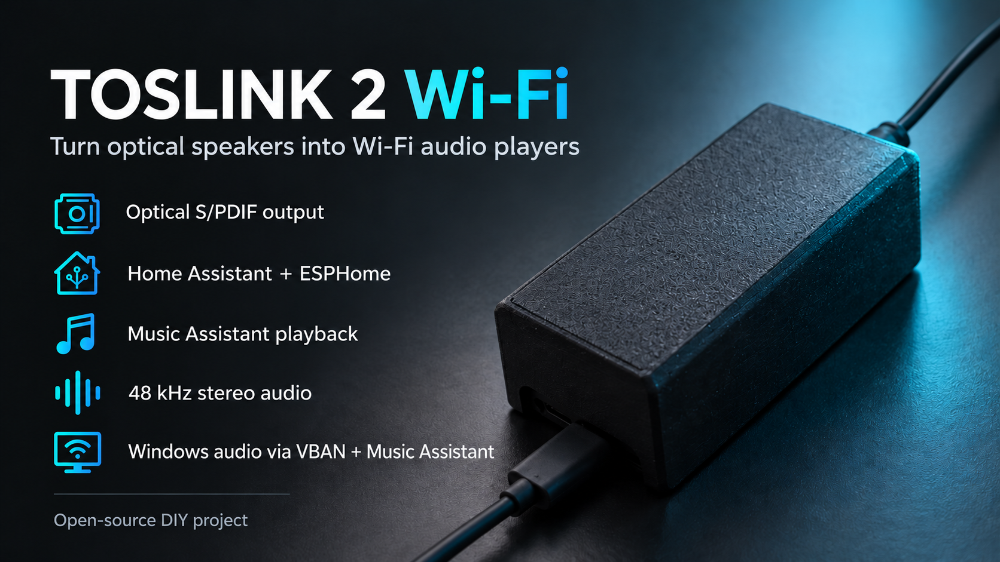

# Optical Audio Bridge



An ESPHome-based Wi-Fi audio endpoint for a soundbar or amplifier with an optical S/PDIF input. Built for a JBL Bar 2.1 Deep Bass, which has no analog AUX input, using an ESP32-S3 and a CLIFF OTJ-5 optical transmitter.

**Status: working prototype.** Home Assistant announcements, Music Assistant audio, the onboard RGB LED, YouTube Music through Music Assistant, and Windows audio through VBAN were heard on the JBL. End-to-end video synchronization and automatic wake/input selection have **not** been measured or established.

```text
Music Assistant ── Home Assistant ── Wi-Fi ── ESP32-S3 ── OTJ-5 ── optical ── soundbar / amplifier
Windows / MPC-HC ── Voicemeeter VBAN ── Music Assistant ── same path ───────────┘
```

This is an ESPHome/Home Assistant media player, not a native Windows audio endpoint, Bluetooth receiver, Google Cast receiver, or DLNA renderer. YouTube Music is accessed through its Music Assistant provider; its own Cast button does not discover this device. Windows audio needs a sender such as Voicemeeter. Music Assistant's VBAN path is not designed for video synchronization; actual latency is unmeasured and may be noticeable. Audio from multiple sources is not simultaneous: select the required source in Music Assistant.

## Build and use

1. Gather the parts and wire the transmitter as described in [Hardware and assembly](docs/HARDWARE.md). Check the actual pin orientation against the linked manufacturer drawing **before applying power**.
2. The generic configuration does not contain the builder's Wi-Fi credentials; see [Software setup](docs/SOFTWARE.md).
3. Use ESPHome Device Builder or ESPHome **2026.9.1** to validate, compile and initially flash [`firmware/optical-audio-bridge.yaml`](firmware/optical-audio-bridge.yaml). The existing [`firmware/jbl-wifi.yaml`](firmware/jbl-wifi.yaml) remains available for the original JBL prototype.
4. Connect your phone to the device's open setup Wi-Fi, open its portal or `http://192.168.4.1/`, and enter your own 2.4 GHz Wi-Fi credentials. Add it to Home Assistant; for music, select its Home Assistant player in Music Assistant.
5. Connect the optical output to a compatible device and select its optical input. Start at moderate volume. The RGB light starts off at reboot. For Windows audio follow [Windows and VBAN](docs/WINDOWS.md).

The first assembled generic unit passed setup, Home Assistant speech and Music Assistant optical playback, RGB and OTA tests. Device Builder discovery worked; adoption and the first update after adoption remain untested. The default API is unencrypted and OTA has no password: anyone with network access can control the device and upload firmware. The setup AP and its firmware-upload portal are also open to anyone nearby while active. Use a trusted network and see [Software setup](docs/SOFTWARE.md) for ways to add security. See the [verification record](docs/DEVELOPMENT.md#verification-record) for details and remaining tests.

The files in `firmware/` are the complete project-specific firmware configuration: there is no custom component to install. ESPHome itself generates the compiled firmware from this configuration and its upstream components. The working configuration uses GPIO4 for S/PDIF and GPIO48 for the board's WS2812-compatible RGB LED.

Prebuilt factory and OTA binaries for the first production firmware, together with SHA-256 checksums, are available in [Release v1.0.0](https://github.com/molnard-labs/toslink-2-wifi/releases/tag/v1.0.0). See the [manufacturing guide](docs/MANUFACTURING.md) before flashing a board.

## Documentation

- [Magyar üzembe helyezési útmutató / Hungarian user setup guide (PDF)](docs/hu/optical-audio-bridge-uzembe-helyezes.pdf)
- [Manufacturing, flashing and first setup](docs/MANUFACTURING.md)
- [Hardware, bill of materials and wiring](docs/HARDWARE.md)
- [ESPHome, Home Assistant and Music Assistant setup](docs/SOFTWARE.md)
- [Windows/MPC-HC and VBAN](docs/WINDOWS.md)
- [Architecture, choices, verification and development](docs/DEVELOPMENT.md)
- [Enclosure and original model attribution](enclosure/README.md)

The original enclosure model is under a separate restrictive licence. The locally modified print file is **not redistributed** here; see the enclosure notes. Source code and original project documentation are available under the [MIT licence](LICENSE); third-party software and designs retain their own licences.
