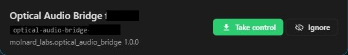

# Manufacturing and first setup

This guide describes how to prepare and check one Optical Audio Bridge. It is a workflow, not evidence that any particular board has passed these checks. Record each unit's results separately. The original JBL prototype and its configuration are distinct from the generic firmware used here.

## 1. Assemble and identify the board

Use an ESP32-S3 N16R8 board and assemble the optical transmitter as described in [Hardware and assembly](HARDWARE.md). With power disconnected, verify the OTJ-5 pin orientation against the manufacturer drawing, its 3.3 V supply, ground, GPIO4 signal and local decoupling capacitor. Check for shorts and provide insulation and cable strain relief. Do not power the transmitter from the 5 V USB rail.

Connect the board to the computer with a **data-capable** USB cable. Identify its serial port by observing which device appears when the board is unplugged and reconnected; do not assume a COM number used on another build. Read the chip and flash information with `esptool` and confirm ESP32-S3, 16 MB flash and 8 MB PSRAM. For example, replace `COM6` below with the verified port:

```powershell
esptool --port COM6 chip-id
esptool --port COM6 flash-id
```

On boards that do not enter the serial bootloader automatically, hold **BOOT**, briefly press and release **RESET/RST**, then release BOOT. If there is no reset button, reconnect USB while holding BOOT. Retry the identification and keep the board in bootloader mode for flashing if necessary. A native USB port and a USB-to-UART port can enumerate differently; select the port that belongs to this physical board.

## 2. Build and flash the selected source

The first manufacturing source baseline is the Git tag `manufacturing-2026-11-07-01`; it pins the Device Builder import as well. A Git tag is not a GitHub Release. Check the source revision and build record for the unit being made before reusing a binary. The tested build environment uses **ESPHome 2026.9.1** and ESP-IDF 5.5.5; `min_version` in the YAML alone does not pin the compiler or dependencies.

From the repository root, create a separate configuration directory with a unique local label, validate, build and flash it. Use the ESPHome 2026.9.1 executable for these commands and replace `COM6` with the identified port:

```powershell
python firmware/prepare_device.py unit-01
esphome config firmware/private-devices/unit-01/optical-audio-bridge.yaml
esphome compile firmware/private-devices/unit-01/optical-audio-bridge.yaml
esphome upload firmware/private-devices/unit-01/optical-audio-bridge.yaml --device COM6
```

Alternatively, a previously built factory binary can be flashed with the appropriate ESPHome/esptool procedure after verifying its source, board compatibility and SHA-256. Record the source commit, tool versions, dependency lock and hashes of both factory and OTA binaries. Keep the exact binary used for the unit. Build timestamps and dependency changes can make a later binary differ even when built from the same source commit.

The generic configuration contains no home Wi-Fi SSID or password, API encryption key or OTA password. An ordinary USB firmware flash does **not** guarantee that Wi-Fi details saved by a previous user have been erased. If a board has been configured before, clear its saved settings using the verified device-specific procedure in [Software setup](SOFTWARE.md) and confirm its setup network returns before handover.

## 3. Configure Wi-Fi and Home Assistant

1. Power the board and connect a phone to its open `optical-audio-bridge-…` setup network. The suffix identifies the individual unit. If the setup page does not appear automatically, open `http://192.168.4.1/` while still connected to that network.
2. Select the owner's **2.4 GHz** Wi-Fi and enter its password on the setup page. The owner should not send the password to the builder. Reconnect the phone to the home network after setup.
3. In Home Assistant, add the discovered ESPHome device; if discovery fails, add it by its IP address. The default generic firmware needs no API key. Confirm that the media player, RGB light and diagnostics are available, and assign the device to the desired room.

The setup access point is open, including the captive portal's firmware-upload function. The normal ESPHome API is unencrypted and OTA has no password: anyone with network access can control the unit and install firmware. Set it up on a trusted network. The owner can later add API encryption and an OTA password using the examples in [Software setup](SOFTWARE.md); those protections do not secure the separate captive portal.

## 4. Optional Device Builder adoption

Once connected, the device may be offered for **Take control** (adoption) in ESPHome Device Builder. The screenshot below shows the first production unit with its identifying suffix redacted. Labels may vary by version.



The first production unit was discovered, but the complete adoption and first update have not yet been verified. If the device is not offered, Device Builder also provides manual configuration creation or file import:


For manual import, use the full YAML from the **selected manufacturing tag**, set `esphome.name` to this unit's full existing MAC-suffixed hostname and set `name_add_mac_suffix: false`, so a later update does not add the suffix twice. Do not add a build-time Wi-Fi SSID or password if the unit uses portal-provisioned settings. Normal OTA updates with an unchanged partition layout can preserve those settings; the first update after manual import has not yet been tested, and partition changes or a full erase can remove them.

## 5. Test and prepare for handover

- Check the RGB entity at low brightness: on, off, red, green and blue; confirm that it starts off after a power cycle. If it does not light, check the board's RGB jumper and GPIO48/GRB configuration.
- Connect a TOSLINK cable to a compatible receiver's **optical input**, select that input and start at moderate volume. Test a Home Assistant announcement and a known Music Assistant track. Enable the Home Assistant player provider in Music Assistant if needed. For the original JBL Bar 2.1 Deep Bass, the optical source is called **TV**.
- Check power cycling and reconnection, then an OTA update if appropriate. Note failures and keep the previous firmware available for recovery. Windows audio through Voicemeeter/VBAN is a separate optional test; see [Windows and VBAN](WINDOWS.md). Do not infer lip-sync performance without measuring it.
- Before handing over a unit tested on the builder's network, remove the builder's saved Wi-Fi details as described in [Software setup](SOFTWARE.md), and verify that the open setup network and portal return. Label the unit so its owner can identify its network. Record results without publishing Wi-Fi passwords, tokens, private network details or identifying hardware addresses.
